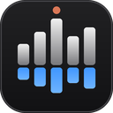
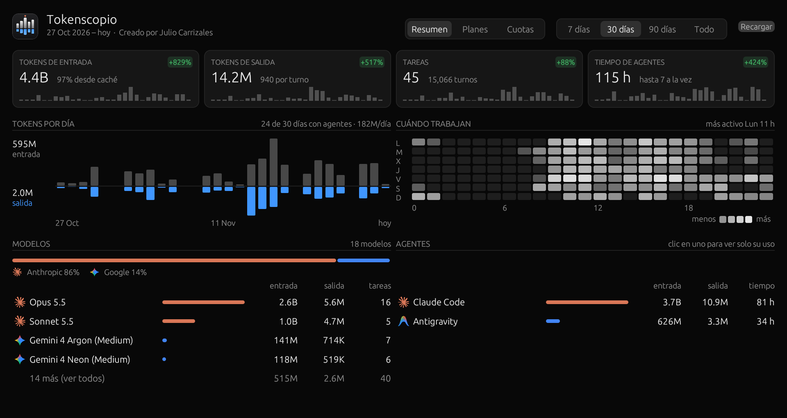
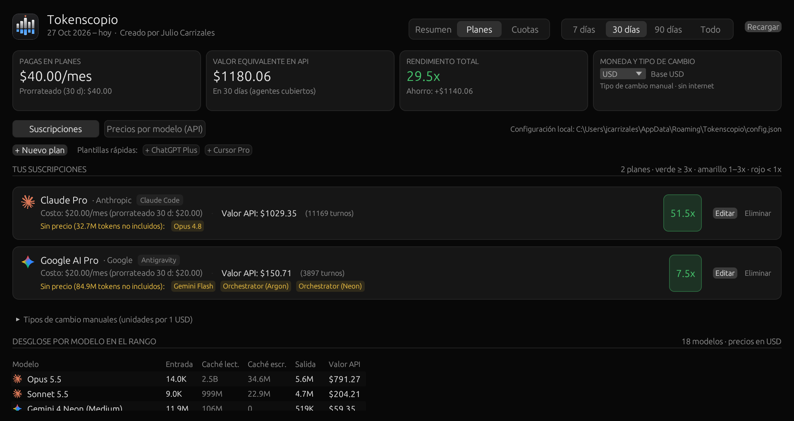
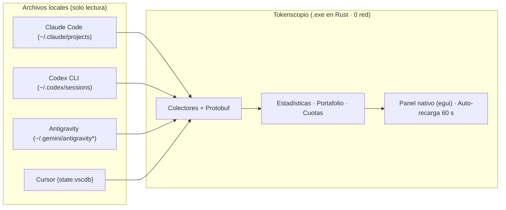

<p align="center">
  
</p>

<h1 align="center">Tokenscopio</h1>

<p align="center">
  <b>Panel de escritorio 100% local para medir cuánto usas tus agentes de IA</b><br>
  Claude Code · Codex · Antigravity · Cursor
</p>

<p align="center">
  
  
  
  
  <a href="https://github.com/JulioCarrizales/tokenscopio/releases"></a>
  <a href="LICENSE"></a>
</p>

<p align="center">
  <a href="#características">Características</a> ·
  <a href="#capturas">Capturas</a> ·
  <a href="#arquitectura-y-privacidad">Privacidad</a> ·
  <a href="#descargar">Descargar</a> ·
  <a href="#compilar">Compilar</a> ·
  <a href="#roadmap">Roadmap</a> ·
  <a href="#preguntas-frecuentes">FAQ</a>
</p>

<br>



## ¿Por qué Tokenscopio?

Cuando trabajas a diario con **Claude Pro**, **ChatGPT Plus**, **Google AI Pro** o **Cursor**, es fácil perder la noción de dos cosas clave: **cuánto valor real le estás sacando a cada suscripción** y **qué tan cerca estás de agotar tus cuotas**.

**Tokenscopio** lee directamente los logs que tus agentes ya guardan en disco y te da un panel claro, rápido y nativo en un solo `.exe`, sin cuentas, sin claves de API y sin mandar un solo byte a internet.

> [!IMPORTANT]
> **100% local y de solo lectura.** Tokenscopio no realiza llamadas de red, no envía telemetría y nunca modifica los archivos de tus agentes. Tu configuración se guarda únicamente en `%APPDATA%\Tokenscopio\config.json`.

---

## Características

<table>
  <tr>
    <td width="50%" valign="top">
      <h3>📊 Resumen, actividad y heatmap</h3>
      <ul>
        <li>Tokens de <b>entrada y salida</b>, % servido desde caché y variación frente al periodo anterior.</li>
        <li><b>Tareas, turnos y tiempo activo</b> de agentes, incluyendo cuántas sesiones corrieron en paralelo.</li>
        <li>Gráfica de <b>tokens por día</b>, <b>heatmap 7×24</b> y desglose interactivo por modelo y agente (clic para filtrar).</li>
        <li>Rangos rápidos de <b>7, 30, 90 días</b> o todo el historial.</li>
      </ul>
    </td>
    <td width="50%" valign="top">
      <h3>💳 Portafolio de planes y ROI</h3>
      <ul>
        <li>Registra tus suscripciones con proveedor, precio mensual, moneda (<code>USD</code>, <code>PEN</code>, <code>MXN</code>, <code>EUR</code>, etc.) y agentes cubiertos.</li>
        <li>Compara lo que pagas (prorrateado al rango) contra el <b>valor equivalente en API</b> con multiplicador (<code>29.5x</code>) y semáforo (verde ≥ 3x · amarillo 1–3x · rojo &lt; 1x).</li>
        <li><b>Tipo de cambio manual</b> y tabla de <b>precios por modelo editable</b> (nunca inventa tarifas: marca <code>sin precio</code>).</li>
      </ul>
    </td>
  </tr>
  <tr>
    <td width="50%" valign="top">
      <h3>🚦 Semáforo de cuotas y ritmo local</h3>
      <ul>
        <li>Lee límites oficiales disponibles en disco (p. ej. <code>rate_limits</code> de Codex) con % usado, ventana y fecha de reinicio.</li>
        <li>Recomendación en una línea indicando cuándo conviene cambiar de agente.</li>
        <li>Para <b>todos los agentes</b> muestra el <b>ritmo local real</b> de las últimas <b>5 h</b> y <b>7 días</b> frente a tu propio pico histórico.</li>
      </ul>
    </td>
    <td width="50%" valign="top">
      <h3>⚡ Nativo, ligero y silencioso</h3>
      <ul>
        <li>Escrito en <b>Rust</b> con interfaz nativa en <a href="https://github.com/emilk/egui">egui</a>.</li>
        <li>Un solo ejecutable <code>tokenscopio.exe</code> sin instalador ni dependencias externas.</li>
        <li><b>Auto-recarga silenciosa</b> cada 60 segundos en segundo plano sin congelar la ventana.</li>
      </ul>
    </td>
  </tr>
</table>

---

## Capturas

<table>
  <tr>
    <td width="50%" align="center">
      <b>Planes — Portafolio de suscripciones y ROI</b><br><br>
      <a href="docs/screenshot-plans.png"></a>
    </td>
    <td width="50%" align="center">
      <b>Cuotas — Semáforo oficial y ritmo 5 h / 7 días</b><br><br>
      <a href="docs/screenshot-quotas.png"></a>
    </td>
  </tr>
</table>

---

## Arquitectura y privacidad



### ¿De dónde salen los datos?

| Agente | Ubicación local | Precisión |
|---|---|---|
| **Claude Code** (CLI y app) | `~/.claude/projects/**/*.jsonl` | Tokens exactos (entrada, caché lectura/escritura, salida) |
| **Codex CLI** | `~/.codex/sessions/**/*.jsonl` | Tokens exactos + cuotas oficiales (`rate_limits`) |
| **Antigravity** (IDE, CLI y agente) | `~/.gemini/antigravity*/conversations/*.db` | Tokens exactos (SQLite + decodificador protobuf propio) |
| **Cursor** | `%APPDATA%\Cursor\User\globalStorage\state.vscdb` | Turnos y tiempo exactos · entrada **estimada** (`≈`) |

---

## Portafolio de suscripciones y precios

Desde la pestaña **Planes** puedes gestionar todo sin salir del modo offline:

1. **Registra tus planes** (o usa las plantillas rápidas: Claude Pro, ChatGPT Plus, Google AI Pro, Cursor Pro) indicando precio mensual, moneda y agentes cubiertos.
2. **Ajusta la moneda y tipo de cambio manual** contra `USD` directamente en la interfaz.
3. **Personaliza precios por modelo (API)** en la sub-pestaña **Precios por modelo (API)** (USD por 1M de tokens: entrada, caché lectura, caché escritura y salida).
4. **Evalúa tu rendimiento**: compara el valor equivalente en API contra el costo prorrateado (`costo_mensual × días / 30`). Si un plan incluye tokens estimados de Cursor, su valor aparece marcado con `≈`.

---

## Descargar

Descarga el binario `tokenscopio.exe` desde [**Releases**](https://github.com/JulioCarrizales/tokenscopio/releases) y ábrelo directamente. No requiere instalación ni configuración previa.

## Compilar

Requisitos en Windows: [Rust](https://rustup.rs) y Visual Studio Build Tools con **“Desarrollo para el escritorio con C++”**.

```powershell
cargo build --release
```

El ejecutable queda en `target\release\tokenscopio.exe`.

> [!TIP]
> Si clonas el proyecto en una ruta muy larga, el linker de Windows puede fallar con `LNK1104` (límite de 260 caracteres). Usa una carpeta temporal corta para compilar:
> ```powershell
> $env:CARGO_TARGET_DIR = "C:\tk-target"; cargo build --release
> ```

---

## Cómo se calcula

- **Turno**: una llamada individual al modelo. **Tarea**: una sesión o conversación completa.
- **Tiempo de agentes**: suma de los intervalos entre llamadas dentro de cada sesión; los huecos mayores a 5 minutos se consideran pausa y no cuentan.
- **Hasta N a la vez**: máximo de sesiones cuyos intervalos (de la primera a la última llamada) se solapan en el tiempo.
- **Ritmo local (5 h y 7 días)**: suma de tokens en las últimas 5 h y 7 días comparada contra el pico histórico de cada agente en una ventana deslizante equivalente.
- **Codex**: sus logs guardan acumulados por sesión, por lo que Tokenscopio calcula las diferencias entre eventos consecutivos.

---

## Roadmap

- [x] Panel principal con tokens, caché, tareas, tiempo activo, concurrencia y heatmap 7×24
- [x] Portafolio de suscripciones con ROI prorrateado, multimoneda manual y tabla editable de precios API
- [x] Pestaña **Cuotas** con límites oficiales de Codex, recomendación automática y ritmo local 5 h / 7 días
- [x] Auto-recarga silenciosa en segundo plano cada 60 s
- [ ] Integración en la UI de **tendencia mensual de ROI**, **proyección de cierre de mes** y **simulador Plan vs API / cambio de tier** *(lógica lista en `portfolio.rs`)*
- [ ] Integración en la UI de **bandeja del sistema** y **alertas nativas de Windows** *(motor listo en `alerts.rs` y `tray.rs`)*
- [ ] Desglose y filtro por proyecto / repositorio
- [ ] Caché incremental de lectura de logs

---

## Preguntas frecuentes

<details>
<summary><b>¿Tokenscopio lee o envía el contenido de mis conversaciones?</b></summary>
<br>
No. Solo lee metadatos numéricos de uso (timestamps, modelo, conteos de tokens y límites locales). No se conecta a internet ni envía nada fuera de tu equipo.
</details>

<details>
<summary><b>¿Por qué Cursor aparece con el símbolo ≈ y sin tokens de salida?</b></summary>
<br>
Cursor no guarda conteos reales de tokens en disco (<code>tokenCount</code> queda en 0). Tokenscopio estima la entrada a partir de <code>contextTokensUsed</code> repartido entre los turnos, y muestra <code>—</code> en la salida para no inventar números.
</details>

<details>
<summary><b>¿Se miden también los chats web (claude.ai, chatgpt.com, gemini.google.com)?</b></summary>
<br>
No. Lo que ocurre en el navegador no se guarda en archivos locales de tu equipo, por lo que no puede leerse de forma local.
</details>

<details>
<summary><b>¿Cómo lee los datos de Antigravity?</b></summary>
<br>
Antigravity guarda cada conversación en SQLite con metadatos en protobuf sin especificación pública. Tokenscopio incluye un decodificador mínimo propio (<code>src/collectors/protobuf.rs</code>); el formato fue deducido y podría cambiar en futuras actualizaciones.
</details>

---

## Estructura del proyecto

```text
src/
  collectors/   un lector por agente + decodificador de protobuf
  model.rs      modelo común de eventos de uso y normalización de nombres
  config.rs     configuración local (%APPDATA%\Tokenscopio\config.json)
  pricing.rs    tabla de precios por modelo (USD por 1M tokens)
  portfolio.rs  valor equivalente en API, prorrateo, ROI, tendencia mensual, proyección y simulador
  quotas.rs     lectura local de cuotas/límites por agente, ritmo local 5 h / 7 días y recomendación
  alerts.rs     motor local de transiciones de alertas (cuotas, reinicios y picos de 5 h) y tooltip
  tray.rs       bandeja del sistema y notificaciones nativas de Windows (FFI Win32, sin crates extra)
  stats.rs      totales, series por día, heatmap, agrupación por modelo y agente
  gui.rs        interfaz principal (egui) y auto-recarga cada 60 s
  gui_plans.rs  vista de Portafolio de suscripciones y editor de precios
  gui_quotas.rs vista de Semáforo de cuotas, ritmo local y recomendación
  main.rs       ventana e ícono
assets/         ícono de la app y logos de marcas
docs/           ícono y capturas de pantalla para el README
```

## Créditos

- Creado por **Julio Carrizales**.
- Interfaz construida con [egui](https://github.com/emilk/egui).
- Logos de marcas de [LobeHub Icons](https://github.com/lobehub/lobe-icons). Las marcas pertenecen a sus respectivos dueños; Tokenscopio no está afiliado a Anthropic, Google, OpenAI, xAI ni Anysphere.

## Licencia

[MIT](LICENSE) © 2026 Julio Carrizales
