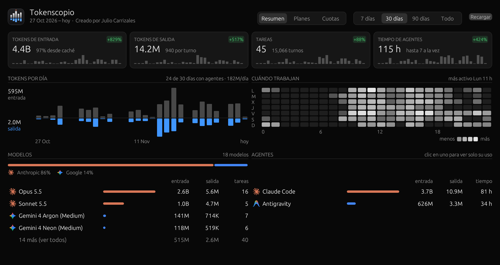
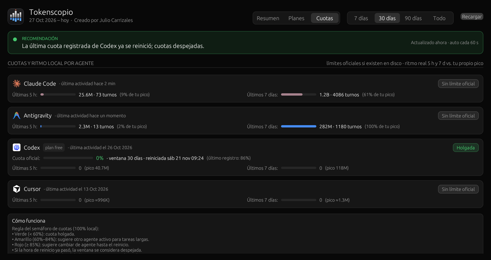

<p align="center">
  
</p>

<h1 align="center">Tokenscopio</h1>

<p align="center">
  Un panel de escritorio para ver <b>cuánto usas tus agentes de IA</b>: Claude Code, Codex, Antigravity y Cursor.<br>
  Hecho en Rust · un solo <code>.exe</code> · 100% local · funciona con tus planes Pro, sin claves de API.
</p>



<details>
<summary>Ver capturas de las pestañas <b>Planes</b> y <b>Cuotas</b></summary>

#### Planes (portafolio de suscripciones y rendimiento)


#### Cuotas (semáforo oficial y ritmo local 5 h / 7 días)


</details>

## ¿Qué muestra?

- **Tokens de entrada y salida**, con el % que vino de caché y el cambio contra el periodo anterior.
- **Tareas, turnos y tiempo de agentes**, incluido cuántas sesiones corrieron a la vez.
- **Tokens por día** (entrada arriba, salida abajo) y un **heatmap** de a qué hora trabajan tus agentes.
- **Modelos y agentes**: clic en un agente para ver solo su uso.
- **Portafolio de suscripciones** (pestaña **Planes**): registra tus suscripciones (proveedor, nombre, precio mensual, moneda y agentes que cubre) y compáralas contra el valor equivalente en API prorrateado al rango seleccionado, con rendimiento (`12.4x`), semáforo (verde ≥ 3x, amarillo 1–3x, rojo < 1x) y tabla de precios por modelo editable.
- **Semáforo de cuotas y ritmo local** (pestaña **Cuotas**): lee los límites oficiales disponibles en disco (p. ej. `rate_limits` de Codex en `~/.codex/sessions`) mostrando % usado, ventana y reinicio, y da una recomendación en una línea (con la regla en tooltip). Además, para **todos** los agentes muestra el **ritmo local real** de las últimas **5 h** y **7 días** comparado contra tu propio pico histórico (los agentes sin límites en disco aparecen como `Sin límite oficial`).
- **Auto-recarga silenciosa**: refresca los logs locales automáticamente cada 60 segundos en segundo plano sin congelar la interfaz.
- Rangos de 7, 30 y 90 días o todo el historial.

## Portafolio de suscripciones y precios

Desde el botón **Planes** en el encabezado puedes gestionar tu portafolio sin salir del modo 100% local:

1. **Registra tus planes** (Anthropic, OpenAI, Google, Cursor u otro): indica nombre, precio mensual, moneda (`USD`, `PEN`, `MXN`, `EUR`, etc.) y qué agentes cubre cada plan (por ejemplo: Claude Pro → Claude Code, ChatGPT Plus → Codex, Google AI Pro → Antigravity, Cursor Pro → Cursor).
2. **Tipo de cambio manual**: elige la moneda de visualización y ajusta el tipo de cambio contra `USD` directamente en la interfaz (sin llamadas a internet).
3. **Precios por modelo (API)**: en la sub-pestaña **Precios por modelo (API)** puedes revisar, editar o agregar precios en USD por millón de tokens (entrada, caché de lectura, caché de escritura y salida). Los modelos sin precio configurado se muestran explícitamente como `sin precio` en lugar de inventar tarifas.
4. **Semáforo de rendimiento**: compara el valor equivalente en API contra el costo del plan prorrateado al rango elegido (`costo_mensual × días / 30`). Verde ≥ 3x, amarillo entre 1x y 3x, rojo < 1x. Si un plan incluye tokens estimados de Cursor, su valor aparece marcado con `≈`.
5. **Almacenamiento local**: toda la configuración (suscripciones, tipos de cambio y tabla de precios) se guarda en `%APPDATA%\Tokenscopio\config.json`. Nada sale de tu equipo.

## ¿De dónde salen los datos?

Tokenscopio **no se conecta a ninguna cuenta ni manda nada a internet**. Lee, en modo de solo lectura, los archivos que cada agente ya guarda en tu equipo:

| Agente | Archivos | Datos |
|---|---|---|
| Claude Code (CLI y pestaña Code de la app) | `~/.claude/projects/**/*.jsonl` | Tokens exactos |
| Codex CLI | `~/.codex/sessions/**/*.jsonl` | Tokens exactos |
| Antigravity (IDE, CLI y agente) | `~/.gemini/antigravity*/conversations/*.db` | Tokens exactos |
| Cursor | `%APPDATA%\Cursor\User\globalStorage\state.vscdb` | Turnos y tiempo exactos; tokens **estimados** (≈) |

Notas:

- **Antigravity** guarda cada conversación como una base SQLite con metadatos en protobuf, sin documentación pública. Tokenscopio incluye un decodificador mínimo de protobuf (`src/collectors/protobuf.rs`); el formato se dedujo y podría cambiar con una actualización.
- **Cursor** no guarda conteos reales de tokens en disco. La entrada se estima con el tamaño del contexto y la salida se muestra como “—”.
- Lo que escribes en los chats web (claude.ai, chatgpt.com, gemini.google.com) no queda en tu equipo, así que no se puede medir.

## Descargar

Descarga `tokenscopio.exe` desde [Releases](../../releases) y ábrelo. No necesita instalación.

## Compilar

Requisitos en Windows: [Rust](https://rustup.rs) y Visual Studio Build Tools con “Desarrollo para el escritorio con C++”.

```powershell
cargo build --release
```

El ejecutable queda en `target\release\tokenscopio.exe`.

> Si el proyecto está en una ruta muy larga, el linker de Windows falla con `LNK1104` (límite de 260 caracteres). Usa una carpeta de salida corta:
> `$env:CARGO_TARGET_DIR = "C:\tk-target"; cargo build --release`

## Cómo se calcula

- **Turno**: una llamada al modelo. **Tarea**: una sesión o conversación.
- **Tiempo de agentes**: suma de los intervalos entre llamadas de cada sesión; los huecos de más de 5 minutos no cuentan.
- **Hasta N a la vez**: máximo de sesiones cuyos intervalos (de la primera a la última llamada) se solapan.
- **Ritmo local (5 h y 7 días)**: suma de tokens en las últimas 5 h y 7 días comparada contra el máximo histórico de cada agente en una ventana deslizante equivalente.
- Codex guarda totales acumulados por sesión; se usan las diferencias entre eventos.

## Estructura

```
src/
  collectors/   un lector por agente + decodificador de protobuf
  model.rs      modelo común de eventos de uso y normalización de nombres
  config.rs     configuración local (%APPDATA%\Tokenscopio\config.json, planes, monedas y preferencias de alertas/bandeja)
  pricing.rs    tabla de precios por modelo (USD por 1M tokens)
  portfolio.rs  cálculo de valor equivalente en API, prorrateo, rendimiento, tendencia mensual, proyección y simulador
  quotas.rs     lectura local de cuotas/límites por agente, ritmo local 5 h / 7 días y recomendación
  alerts.rs     motor local de transiciones de alertas (cuotas, reinicios y picos de 5 h) y tooltip de bandeja
  tray.rs       bandeja del sistema y notificaciones nativas de Windows (FFI Win32, sin dependencias extra)
  stats.rs      totales, series por día, heatmap, agrupación por modelo y agente
  gui.rs        interfaz principal (egui) y auto-recarga cada 60 s
  gui_plans.rs  vista de Portafolio de suscripciones y editor de precios
  gui_quotas.rs vista de Semáforo de cuotas, ritmo local y recomendación
  main.rs       ventana e ícono
assets/         ícono de la app y logos de marcas
```

## Créditos

- Creado por **Julio Carrizales**.
- Interfaz con [egui](https://github.com/emilk/egui).
- Logos de marcas de [LobeHub Icons](https://github.com/lobehub/lobe-icons). Las marcas pertenecen a sus respectivos dueños; Tokenscopio no está afiliado a Anthropic, Google, OpenAI, xAI ni Anysphere.

## Licencia

[MIT](LICENSE) © 2026 Julio Carrizales
